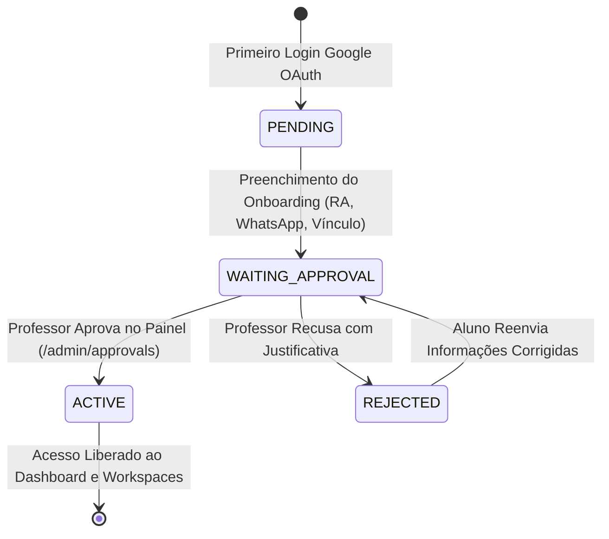

# 🗺️ ROADMAP & GUIA DE ARQUITETURA — LABGEST CTPP (UNIFESP)

> **Documento Vivo de Referência e Memória do Projeto**  
> Este documento centraliza os objetivos, arquitetura técnica, regras de negócio, ciclo de vida de dados e o checklist de execução do **LabGest / Living Lab CTPP**. Qualquer alteração de arquitetura ou avanço de funcionalidade deve ser refletido aqui.

---

## 1. Visão Geral do Projeto

- **Nome da Aplicação:** LabGest CTPP (Centro de Tecnologia e Políticas Públicas — UNIFESP).
- **Missão:** Plataforma integrada para gestão de projetos científicos e tecnológicos, controle de atividades por quadros Kanban dinâmicos, apontamento auditável de horas de bolsistas/pesquisadores e cadernos de laboratório (Docs/Notion-like).
- **Problema que Resolve:** Elimina o uso fragmentado de planilhas Excel, formulários dispersos do Google Forms e perda de histórico de pesquisa, unificando a prestação de contas (FAPESP, CNPq, CAPES e parcerias institucionais como EMBRAPA).

---

## 2. Stack Tecnológica e Arquitetura

| Camada | Tecnologia | Descrição & Decisão de Arquitetura |
| :--- | :--- | :--- |
| **Framework Fullstack** | **Next.js 14 (App Router)** | Server Components por padrão para performance e SEO; Client Components (`'use client'`) estritamente onde há interatividade de UI. |
| **Linguagem** | **TypeScript 5** | Tipagem estrita ponta a ponta (`strict: true`), evitando `any` nas entidades de domínio. |
| **Estilização** | **Tailwind CSS + shadcn/ui** | Design System customizado com paleta institucional UNIFESP / Living Lab (Verde Bandeira, Azul Petróleo, Laranja Queimado). |
| **Banco de Dados** | **PostgreSQL 16 (Docker)** | Banco relacional robusto com integridade referencial, cascata em deleções de tarefas e enumerações nativas. |
| **ORM & Migrations** | **Prisma ORM** | Schema centralizado em `prisma/schema.prisma` com geração de tipos estáticos (`npx prisma generate`). |
| **Autenticação** | **NextAuth.js v4** | Integração com **Google OAuth**, suporte a credenciais de teste para dev e validação Just-in-Time (JIT) de domínios permitidos (`@unifesp.br`, `@aluno.unifesp.br`). |
| **Ambiente de Execução** | **Docker & Docker Compose** | Arquitetura multi-container (`labgest_web` em Node 20 Alpine e `labgest_postgres` em PostgreSQL 16 Alpine). |

---

## 3. Regras de Negócio e Hierarquia (Roles & Status)

### 3.1. Papéis de Usuário (`Role`)
1. **`PROFESSOR` (Administrador / Coordenador Geral):**
   - Acesso total à plataforma.
   - Aprovação ou recusa de novos workspaces de pesquisa (`/admin/approvals`).
   - Aprovação de novos alunos/bolsistas e atribuição aos seus respectivos workspaces.
   - Configuração de identidade visual e parâmetros institucionais (White-label).
2. **`LEADER` (Pesquisador Líder / Pós-Doutorando / Co-coordenador):**
   - Gestão de workspaces específicos onde foi designado como líder.
   - Criação de buckets, atividades e atribuição de tarefas a pesquisadores.
   - Validação dos relatórios de horas dos estudantes vinculados ao seu projeto.
3. **`STUDENT` (Iniciação Científica / Mestrando / Bolsista):**
   - Visualização dos workspaces aos quais pertence.
   - Movimentação de tarefas no Kanban (Drag & Drop) e alteração de status/campos.
   - **Apontamento de horas de pesquisa** dentro das atividades ou no apontador geral.
   - Redação de anotações no Caderno de Laboratório.

### 3.2. Ciclo de Vida do Usuário (`UserStatus`)

- **`PENDING`:** Usuário autenticou via Google mas não completou o cadastro inicial (redirecionado automaticamente para `/onboarding`).
- **`WAITING_APPROVAL`:** Usuário preencheu seus dados acadêmicos e aguarda liberação de um Professor (retido na `/waiting-room`).
- **`ACTIVE`:** Acesso regular liberado a todos os módulos autorizados.
- **`REJECTED`:** Acesso não homologado pela coordenação.

---

## 4. Roadmap e Checklist de Execução

### Fase 1: Recuperação e Estrutura Visual Base
- [x] Correção de rotas e links quebrados (migração de `<a href="#">` para `<Link href="...">`).
- [x] Refatoração do Header global com exibição dinâmica do usuário autenticado, badge de perfil e logout via NextAuth.
- [x] Sidebar dinâmica com listagem de Workspaces aprovados do banco de dados e contadores reais.
- [x] Eliminação do botão de apontamento solto no header; migração do apontamento para o Dashboard e para o interior do card no Kanban.
- [x] Design responsivo com remoção de overflows indesejados e caixas modais sobrepostas.

### Fase 2: Autenticação e Onboarding JIT
- [x] Configuração do NextAuth com Google Provider e verificação de domínio institucional (`ALLOWED_EMAIL_DOMAINS`).
- [x] Formulário de Onboarding (`/onboarding`) com validação de RA, curso, nível (Graduação/Mestrado/Doutorado) e telefone/WhatsApp.
- [x] Middleware de proteção de rotas com interceptação de status (`PENDING` -> `/onboarding`, `WAITING_APPROVAL` -> `/waiting-room`).
- [x] Tela de Sala de Espera (`/waiting-room`) amigável com botão de atualizar status e suporte de contato.

### Fase 3: Gestão e Triagem (Painel do Professor)
- [x] Tela de Aprovações de Workspaces e Alunos (`/admin/approvals`).
- [x] Server Action para aprovação de Workspace com justificativa (`approveWorkspace`).
- [x] Server Action para rejeição de Workspace (`rejectWorkspace`).
- [x] Atribuição automática de permissões e vínculos de membros ao workspace aprovado.

### Fase 4: Core Engine — Kanban Interativo e Apontamento de Horas
- [x] **Criação Dinâmica de Buckets/Colunas:**
  - [x] Server Action `createKanbanColumn` em `src/app/actions.ts`.
  - [x] Componente UI "+ Adicionar Novo Bucket" com input inline, validação e cores no Kanban.
- [x] **Drag & Drop Nativo entre Buckets:**
  - [x] HTML5 Drag & Drop com feedback visual de hover (`ring-2 ring-primary/30`, drop target container).
  - [x] Atualização de estado otimista (sem lag de interface) e persistência via Server Action `moveTask`.
- [x] **Edição Completa de Todos os Campos do Card:**
  - [x] Modal `TaskDetailDialog` montado via `createPortal(..., document.body)` para evitar cortes de backdrop.
  - [x] Título editável in-place.
  - [x] Dropdown para troca de Coluna/Bucket direto pelo modal.
  - [x] Dropdown seletor de Prioridade (`LOW`, `MEDIUM`, `HIGH`, `URGENT`).
  - [x] Campo seletor de Prazo de Conclusão (`input type="date"`).
  - [x] Seletor interativo de Pesquisadores Atribuídos (chips clicáveis com avatar e checkmark).
  - [x] Textarea de Descrição Técnica & Metodologia de Pesquisa.
  - [x] Botão "Salvar Alterações" com feedback visual de sucesso/erro e Server Action `updateTask`.
  - [x] Botão de exclusão de atividade com confirmação e Server Action `deleteTask`.
- [x] **Apontamento de Horas Integrado no Card:**
  - [x] Bloco de destaque com contador de horas acumuladas na tarefa (`formatMinutesToHours`).
  - [x] Botão permanente e visível **"Apontar Horas"** dentro do bloco da atividade.
  - [x] Alternância suave entre os modos `"details"` e `"log-time"` na mesma caixa (sem abrir modal sobre modal).
  - [x] Histórico de apontamentos da tarefa visível com data e resumo.

### Fase 5: Configurações White-label e Expansão
- [x] Modelo `PlatformSettings` no banco de dados para personalização.
- [x] Página de configurações institucionais (`/admin/settings`).
- [x] Server Action `updatePlatformSettings` para atualizar nome do lab, instituição, cores primária/secundária e e-mail de suporte.
- [ ] Exportação de relatórios de horas por bolsista e por projeto em CSV/PDF para prestação de contas FAPESP/CNPq.
- [ ] Módulo de Caderno de Laboratório enriquecido com suporte a Markdown/Editor rico e anexos de arquivos.

---

## 5. Diretrizes Obrigatórias para a IA (System Prompting & Regras de Preservação)

> **ATENÇÃO — INSTRUÇÃO CRÍTICA PARA AGENTES DE IA (ANTIGRAVITY / COPILOT):**
> 
> 1. **MEMÓRIA OBRIGATÓRIA:** Antes de propor ou realizar qualquer modificação no código, **LEIA ESTE ARQUIVO (`ROADMAP.md`)**.
> 2. **PROIBIDO DELETAR COMPONENTES ESTÁVEIS:** NUNCA remova, comente ou substitua componentes que já foram aprovados pelo usuário (em especial: botões de ação nos modais, botão "Apontar Horas", botões de "Salvar Alterações", filtros e a barra lateral).
> 3. **DESIGN SYSTEM & ESTÉTICA:**
>    - Nunca utilize janelas modais empilhadas em cascata ("caixa em cima de outra caixa"). Se um modal precisar de um subfluxo, use alternância de estado de visualização interna (`mode: 'details' | 'form'`).
>    - Sempre renderize modais globais via `createPortal(..., document.body)` para cobrir uniformemente toda a tela com o backdrop escurecido.
>    - Utilize cores harmoniosas da paleta do Living Lab (`hsl(var(--primary))`, verde esmeralda institucional, tons neutros slate/zinc).
> 4. **ATUALIZAÇÃO DE STATUS:** Sempre que uma tarefa deste roadmap for iniciada, alterada ou concluída, atualize os checkboxes (`[ ]` -> `[x]`) e as anotações deste documento.
> 5. **SINCRONIZAÇÃO DOCKER:** Lembre-se de que a aplicação roda em contêineres Docker de produção (`labgest_web`). Alterações no código-fonte Next.js só surtem efeito no navegador do usuário após a recompilação bem-sucedida do serviço web (`docker compose build web && docker compose up -d web`).
