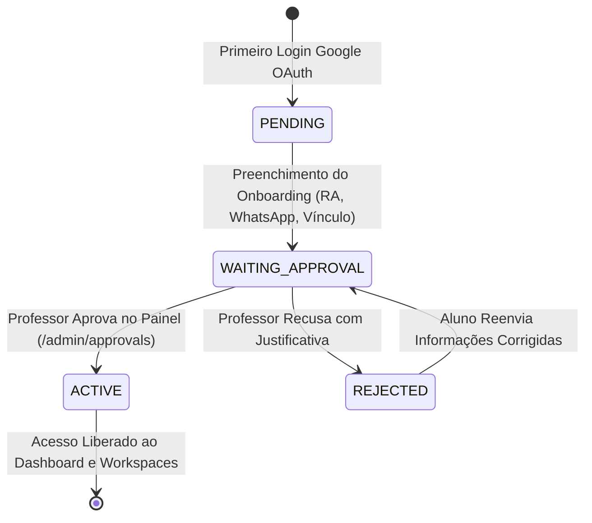

# 🗺️ ROADMAP & GUIA DE ARQUITETURA — LABGEST CTPP (UNIFESP)

> **Documento Vivo de Referência e Memória do Projeto**  
> Este documento centraliza os objetivos, arquitetura técnica, regras de negócio, ciclo de vida de dados e o checklist de execução do **LabGest / Living Lab CTPP**. Qualquer alteração de arquitetura ou avanço de funcionalidade deve ser refletido aqui.

---

## 1. Visão Geral do Projeto

- **Nome da Aplicação:** LabGest CTPP (Centro de Tecnologia e Políticas Públicas — UNIFESP).
- **Missão:** Plataforma integrada para gestão de projetos científicos e tecnológicos, controle de atividades por quadros Kanban dinâmicos, apontamento auditável de horas de bolsistas/pesquisadores e cadernos de laboratório (Docs/Notion-like).
- **Problema que Resolve:** Elimina o uso fragmentado de planilhas Excel, formulários dispersos do Google Forms e perda de histórico de pesquisa, unificando a prestação de contas (FAPESP, CNPq, CAPES e parcerias institucionais como EMBRAPA).

---

## 2. Stack Tecnológica e Arquitetura

| Camada | Tecnologia | Descrição & Decisão de Arquitetura |
| :--- | :--- | :--- |
| **Framework Fullstack** | **Next.js 14 (App Router)** | Server Components por padrão para performance e SEO; Client Components (`'use client'`) estritamente onde há interatividade de UI. |
| **Linguagem** | **TypeScript 5** | Tipagem estrita ponta a ponta (`strict: true`), evitando `any` nas entidades de domínio. |
| **Estilização** | **Tailwind CSS + shadcn/ui** | Design System customizado com paleta institucional UNIFESP / Living Lab (Verde Bandeira, Azul Petróleo, Laranja Queimado). |
| **Banco de Dados** | **PostgreSQL 16 (Docker)** | Banco relacional robusto com integridade referencial, cascata em deleções de tarefas e enumerações nativas. |
| **ORM & Migrations** | **Prisma ORM** | Schema centralizado em `prisma/schema.prisma` com geração de tipos estáticos (`npx prisma generate`). |
| **Autenticação** | **NextAuth.js v4** | Integração com **Google OAuth**, suporte a credenciais de teste para dev e validação Just-in-Time (JIT) de domínios permitidos (`@unifesp.br`, `@aluno.unifesp.br`). |
| **Ambiente de Execução** | **Docker & Docker Compose** | Arquitetura multi-container (`labgest_web` em Node 20 Alpine e `labgest_postgres` em PostgreSQL 16 Alpine). |

---

## 3. Regras de Negócio e Hierarquia (Roles & Status)

### 3.1. Papéis Institucionais (`Role`) e Atribuições Modulares (`Attribution`)
1. **`PROFESSOR` (Professor / Coordenação Geral):**
   - Acesso irrestrito a todas as áreas e configurações da plataforma.
   - Triagem e homologação de novos integrantes e workspaces (`/admin/approvals`).
   - Gestão de papéis institucionais e atribuições da equipe (`/members`).
   - Configuração de identidade visual e parâmetros institucionais (White-label).
2. **`LEADER` (Líder — Gestão):**
   - Coordenação operacional e liderança dos workspaces aos quais pertence.
   - Criação de colunas no Kanban, organização de atividades e alocação de integrantes.
   - Acompanhamento de entregas e validação de relatórios de horas.
3. **`STUDENT` (Integrante):**
   - Membro da equipe do laboratório (bolsista, aluno ou colaborador técnico).
   - Movimentação de tarefas no Kanban (Drag & Drop) e alteração de status/campos.
   - Apontamento de horas nas atividades ou no apontador geral.
   - Colaboração e redação de notas nos Cadernos do Workspace e Caderno Pessoal.

> **Nota de Arquitetura (Modelo Flexível de Atribuições):**  
> No Living Lab, nem todos os colaboradores trabalham estritamente com pesquisa científica. O sistema separa a **Função Institucional Base** (`Professor`, `Líder (Gestão)`, `Integrante`) das **Atribuições Modulares Dinâmicas** (`Attribution`), permitindo que integrantes acumulem especialidades (ex: *Gestão*, *Pesquisa*, *Infraestrutura & TI*, *Comunicação & Mídia*, *Administrativo & Financeiro*) e tenham acesso configurável a cada módulo do sistema.

### 3.2. Ciclo de Vida do Usuário (`UserStatus`)

- **`PENDING`:** Usuário autenticou via Google mas não completou o cadastro inicial (redirecionado automaticamente para `/onboarding`).
- **`WAITING_APPROVAL`:** Usuário preencheu seus dados acadêmicos e aguarda liberação de um Professor (retido na `/waiting-room`).
- **`ACTIVE`:** Acesso regular liberado a todos os módulos autorizados.
- **`REJECTED`:** Acesso não homologado pela coordenação.

---

## 4. Roadmap e Checklist de Execução

### Fase 1: Recuperação e Estrutura Visual Base
- [x] Correção de rotas e links quebrados (migração de `<a href="#">` para `<Link href="...">`).
- [x] Refatoração do Header global com exibição dinâmica do usuário autenticado, badge de perfil e logout via NextAuth.
- [x] Sidebar dinâmica com listagem de Workspaces aprovados do banco de dados e contadores reais.
- [x] Eliminação do botão de apontamento solto no header; migração do apontamento para o Dashboard e para o interior do card no Kanban.
- [x] Design responsivo com remoção de overflows indesejados e caixas modais sobrepostas.

### Fase 2: Autenticação e Onboarding JIT
- [x] Configuração do NextAuth com Google Provider e verificação de domínio institucional (`ALLOWED_EMAIL_DOMAINS`).
- [x] Formulário de Onboarding (`/onboarding`) com validação de RA, curso, nível (Graduação/Mestrado/Doutorado) e telefone/WhatsApp.
- [x] Middleware de proteção de rotas com interceptação de status (`PENDING` -> `/onboarding`, `WAITING_APPROVAL` -> `/waiting-room`).
- [x] Tela de Sala de Espera (`/waiting-room`) amigável com botão de atualizar status e suporte de contato.

### Fase 3: Gestão e Triagem (Painel do Professor)
- [x] Tela de Aprovações de Workspaces e Alunos (`/admin/approvals`).
- [x] Server Action para aprovação de Workspace com justificativa (`approveWorkspace`).
- [x] Server Action para rejeição de Workspace (`rejectWorkspace`).
- [x] Atribuição automática de permissões e vínculos de membros ao workspace aprovado.

### Fase 4: Core Engine — Kanban Interativo e Apontamento de Horas
- [x] **Criação Dinâmica de Buckets/Colunas:**
  - [x] Server Action `createKanbanColumn` em `src/app/actions.ts`.
  - [x] Componente UI "+ Adicionar Novo Bucket" com input inline, validação e cores no Kanban.
- [x] **Drag & Drop Nativo entre Buckets:**
  - [x] HTML5 Drag & Drop com feedback visual de hover (`ring-2 ring-primary/30`, drop target container).
  - [x] Atualização de estado otimista (sem lag de interface) e persistência via Server Action `moveTask`.
- [x] **Edição Completa de Todos os Campos do Card:**
  - [x] Modal `TaskDetailDialog` montado via `createPortal(..., document.body)` para evitar cortes de backdrop.
  - [x] Título editável in-place.
  - [x] Dropdown para troca de Coluna/Bucket direto pelo modal.
  - [x] Dropdown seletor de Prioridade (`LOW`, `MEDIUM`, `HIGH`, `URGENT`).
  - [x] Campo seletor de Prazo de Conclusão (`input type="date"`).
  - [x] Seletor interativo de Pesquisadores Atribuídos (chips clicáveis com avatar e checkmark).
  - [x] Textarea de Descrição Técnica & Metodologia de Pesquisa.
  - [x] Botão "Salvar Alterações" com feedback visual de sucesso/erro e Server Action `updateTask`.
  - [x] Botão de exclusão de atividade com confirmação e Server Action `deleteTask`.
- [x] **Apontamento de Horas Integrado no Card:**
  - [x] Bloco de destaque com contador de horas acumuladas na tarefa (`formatMinutesToHours`).
  - [x] Botão permanente e visível **"Apontar Horas"** dentro do bloco da atividade.
  - [x] Alternância suave entre os modos `"details"` e `"log-time"` na mesma caixa (sem abrir modal sobre modal).
  - [x] Histórico de apontamentos da tarefa visível com data e resumo.

### Fase 5: Cadernos e Documentação Colaborativa dos Workspaces (Docs/Notion-like)
- [x] Listagem dos cadernos por workspace com autor e data de atualização (`/workspace/[id]/docs`).
- [x] Modal de criação de novos cadernos/páginas (`CreateDocumentDialog`).
- [x] **Edição Funcional dos Cadernos do Workspace (Notion & OneNote inspired):**
  - [x] Rota dinâmica do editor `/workspace/[id]/docs/[docId]` e rota `/docs/[docId]`.
  - [x] Editor interativo em blocos (BlockNote / Notion-like) com cabeçalhos, checklists, tabelas e comandos slash (`/`).
  - [x] Banner de Capa personalizável (Notion Cover) com presets científicos e URLs customizadas.
  - [x] Seletor interativo de Ícone / Emoji com paleta curada de pesquisa e biotecnologia.
  - [x] Painel lateral retrátil de navegação de páginas inspirado no Microsoft OneNote com busca instantânea.
  - [x] Título editável inline sem bordas e com sincronização automática.
  - [x] Server Action `updateWorkspaceDocument({ docId, title, content, icon, coverImage })` para persistência no PostgreSQL.
  - [x] Sistema de autosave debounced com status visual (`Salvando...`, `Salvo`) e botão explícito "Salvar" (`Ctrl+S`).
  - [x] Exibição de autor e timestamp real da última alteração (`updatedAt`).
  - [x] Exclusão e confirmação de cadernos diretamente no editor com `deleteWorkspaceDocument`.
  - [x] Abertura direta do editor a partir dos cards de cadernos nos workspaces e na listagem central.
  - [x] **Estabilização de Sessão & Editor BlockNote (Deploy Resiliente AWS):**
    - [x] Helper central `getAuthenticatedUser()` protegendo todas as Server Actions contra violações de chave estrangeira (`Task_createdById_fkey`, `Workspace_approvedById_fkey`).
    - [x] Auto-sincronização de usuário no callback JWT de NextAuth para tokens legados em bancos recriados.
    - [x] Integração completa de `@blocknote/mantine` com menus flutuantes, comandos slash (`/`) e proteção por `EditorErrorBoundary`.
    - [x] Inicialização idempotente do banco de dados no `docker-compose.yml` (`command: sh -c "npx prisma db push --skip-generate && npm start"`).

### Fase 6: Configurações White-label e Expansão
- [x] Modelo `PlatformSettings` no banco de dados para personalização.
- [x] Página de configurações institucionais (`/admin/settings`).
- [x] Server Action `updatePlatformSettings` para atualizar nome do lab, instituição, cores primária/secundária e e-mail de suporte.
- [x] Suporte completo a alteração de **Logotipo do Laboratório** (exibido na sidebar e login) e **Favicon** da aba do navegador.
- [x] Configuração da **Cor das Fontes em ambos os modos (Modo Claro e Modo Escuro)** com injeção dinâmica de CSS variables (`--foreground`).
- [x] Painel interativo de **Exemplos de Estilização em Tempo Real (Showcase White-label)** com alternador de temas Claro/Escuro, simulação de aba do navegador, tipografia e componentes UI.
- [x] Otimização e calibração de contraste no tema escuro (Dark Mode WCAG AAA para `--primary`, `--secondary`, botões e textos).
- [ ] Exportação de relatórios de horas por bolsista e por projeto em CSV/PDF para prestação de contas FAPESP/CNPq.

### Fase 7: Controle de Integrantes & Atribuições Customizáveis (RBAC Dinâmico e Multi-Atribuições)
- [x] **Modelagem de Dados e Relacionamentos no Prisma:**
  - [x] Modelos `Attribution` e `UserAttribution` com integridade referencial, cascata e índices em `prisma/schema.prisma`.
  - [x] Relação n:n entre `User` e `Attribution` permitindo que integrantes acumulem múltiplas frentes de atuação.
- [x] **Normalização Universal das Funções Institucionais:**
  - [x] Rótulos institucionais normalizados: **`Professor`**, **`Líder (Gestão)`** e **`Integrante`**.
  - [x] Substituição de termos restritivos como "Líder de Pesquisa" e "Pesquisador" em formulários, modais, cabeçalho e triagem.
- [x] **Nova Aba / Rota de Controle de Integrantes (`/members`):**
  - [x] Adição do link "Integrantes" na barra lateral de navegação (Sidebar).
  - [x] Dashboard analítico com cards de métricas (Total de Integrantes, Ativos, Sala de Espera e Atribuições Criadas).
  - [x] Aba de Integrantes com busca instantânea (nome, email, RA, curso), filtros combinados (função, status, atribuição) e alternador de visualização (Cards / Tabela).
  - [x] Exibição de chips coloridos de todas as atribuições vinculadas a cada integrante.
  - [x] Exibição em tempo real dos módulos do sistema acessíveis pelo integrante.
- [x] **Gestão Modular de Atribuições & Matriz de Permissões:**
  - [x] Aba dedicada para gestão de atribuições do laboratório.
  - [x] Modal `AttributionDialog` para criação e edição de atribuições com nome, cor institucional (presets e color picker), descrição e seleção modular de acessos aos módulos (`workspaces`, `workspaces_admin`, `time_tracking`, `docs`, `calendar`, `members_view`, `members_manage`, `approvals`, `platform_settings`, `reports`).
  - [x] Exclusão segura de atribuição com desvinculação em cascata.
  - [x] Modal `EditMemberDialog` para alteração in-place da função institucional, status e seleção de múltiplas atribuições.
  - [x] Seeding de atribuições padrão do Living Lab (Coordenação & Gestão, Pesquisa & Desenvolvimento, Infraestrutura & TI, Comunicação & Mídia, Administrativo & Financeiro).

### Fase 8: Arquitetura Multi-Tenant (Multi-Laboratórios em Endpoint Único)
- [x] **Modelagem Relacional Multi-Tenant (`Laboratory` & `LabMembership`):**
  - [x] Entidade `Laboratory` (Tenant raiz) com configurações White-label integradas e coordenador responsável (`responsibleId`).
  - [x] Entidade `LabMembership` gerenciando o vínculo, papel (`PROFESSOR`, `LEADER`, `STUDENT`) e status (`WAITING_APPROVAL`, `ACTIVE`, `REJECTED`, `SUSPENDED`) individualmente por laboratório.
  - [x] Adição da coluna discriminadora `labId` com índices compostos B-Tree (`@@index([labId, ...])`) nas entidades `Workspace`, `KanbanColumn`, `Task`, `Tag`, `TimeEntry`, `Document`, `Attribution`, `UserAttribution` e `PlatformSettings`.
- [x] **Migração Idempotente Zero Data Loss (`scripts/migrate-multitenant.js`):**
  - [x] Preservação integral de todos os registros existentes vinculando-os automaticamente ao laboratório inaugural **Lab CTPP (`lab-ctpp`)**.
  - [x] Sincronização automática de `LabMembership` para todos os usuários já cadastrados sem perda de histórico.
- [x] **Fluxo de Login, Seleção de Laboratório (`/labs`) e Triagem Descentralizada:**
  - [x] Escolha do(s) laboratório(s) desejado(s) para triagem durante o `/onboarding` ou posteriormente pelo portal `/labs`.
  - [x] Exibição pós-login de todos os laboratórios disponíveis para acesso (`/labs`) nos quais o usuário já foi homologado, além de seletor rápido na Sidebar.
  - [x] Triagem e homologação de solicitações (`LabMembership` em `WAITING_APPROVAL`) acessível tanto pelo **Responsável do Laboratório (`PROFESSOR`)** quanto pelos **Líderes (`LEADER`)** daquele laboratório (`/admin/approvals` e Dashboard).
  - [x] Isolamento de White-label (`PlatformSettings`) por laboratório ativo na sessão (`labgest_active_lab`).

---

## 5. Diretrizes Obrigatórias para a IA (System Prompting & Regras de Preservação)

> **ATENÇÃO — INSTRUÇÃO CRÍTICA PARA AGENTES DE IA (ANTIGRAVITY / COPILOT):**
> 
> 1. **MEMÓRIA OBRIGATÓRIA:** Antes de propor ou realizar qualquer modificação no código, **LEIA ESTE ARQUIVO (`ROADMAP.md`)**.
> 2. **PROIBIDO DELETAR COMPONENTES ESTÁVEIS:** NUNCA remova, comente ou substitua componentes que já foram aprovados pelo usuário (em especial: botões de ação nos modais, botão "Apontar Horas", botões de "Salvar Alterações", filtros e a barra lateral).
> 3. **DESIGN SYSTEM & ESTÉTICA:**
>    - Nunca utilize janelas modais empilhadas em cascata ("caixa em cima de outra caixa"). Se um modal precisar de um subfluxo, use alternância de estado de visualização interna (`mode: 'details' | 'form'`).
>    - Sempre renderize modais globais via `createPortal(..., document.body)` para cobrir uniformemente toda a tela com o backdrop escurecido.
>    - Utilize cores harmoniosas da paleta do Living Lab (`hsl(var(--primary))`, verde esmeralda institucional, tons neutros slate/zinc).
> 4. **ATUALIZAÇÃO DE STATUS:** Sempre que uma tarefa deste roadmap for iniciada, alterada ou concluída, atualize os checkboxes (`[ ]` -> `[x]`) e as anotações deste documento.
> 5. **SINCRONIZAÇÃO DOCKER:** Lembre-se de que a aplicação roda em contêineres Docker de produção (`labgest_web`). Alterações no código-fonte Next.js só surtem efeito no navegador do usuário após a recompilação bem-sucedida do serviço web (`docker compose build web && docker compose up -d web`).
